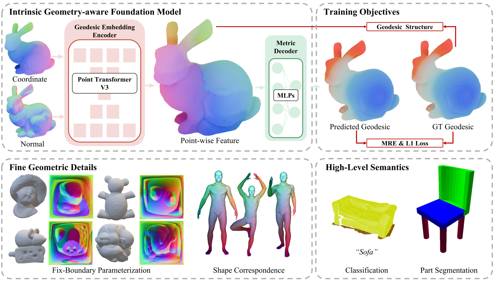

<div align="center">

# PRISM

### From Extrinsic to Intrinsic: Geodesic-Guided Representation Learning for 3D Geometric Data

**ICML 2026**

Yuming Zhao · Junhui Hou · Qijian Zhang · Jia Qin · Ying He

[](https://arxiv.org/abs/2606.02268)
[](https://arxiv.org/abs/2606.02268)
[](https://huggingface.co/AidenZhaoy/PRISM)
[](LICENSE)
<br>
[](https://www.python.org/)
[](https://pytorch.org/)
[](https://github.com/AidenZhao/PRISM)

</div>

<p align="center">
  
</p>

PRISM learns point-cloud representations by predicting **geodesic distances** between arbitrary pairs of points on the underlying surface, from the point cloud alone. This repository is the official implementation.

<sub>Overview of PRISM as presented in the paper: an intrinsic geometry-aware foundation model trained with geodesic structure and geodesic prediction objectives, which benefits downstream tasks that need fine geometric details and high-level semantics. In PRISM v2 (this release) the Point Transformer V3 encoder is replaced by an anchor-attention transformer; see [Method](#method).</sub>

## News

- **2026-10** — Released **PRISM v2**: a lighter anchor-attention backbone with lower error at every model size, plus the full data pipeline, training and evaluation code.
- **2026-10** — Pretrained PRISM v2 weights (S, B, L) on [Hugging Face](https://huggingface.co/AidenZhaoy/PRISM).

## Contents

- [PRISM v2: lighter and more accurate](#prism-v2-lighter-and-more-accurate)
- [Method](#method) · [Results](#results) · [Pretrained models](#pretrained-models)
- [Installation](#installation) · [Data](#data) · [Training](#training) · [Evaluation](#evaluation) · [Inference](#inference)
- [Differences from the paper](#differences-from-the-paper) · [License](#license) · [Citation](#citation)

## PRISM v2: lighter and more accurate

This release is an **improved version of PRISM**. The paper's Point Transformer V3 encoder–decoder is replaced by a
simple **anchor-attention transformer** built only from standard attention. On the same data and evaluation protocol:

- **Lighter**: every v2 model has about **half the parameters** of its paper counterpart (15M / 61M / 251M vs. 31M / 124M / 494M).
- **More accurate**: v2 lowers the mean relative error at every size, e.g. **PRISM-B: 4.4% → 1.60%** MRE. Even the smallest v2 model (15M, 2.21%) outperforms the largest paper model (494M, 3.9%).
- **Simpler**: no sparse-convolution or serialization dependencies, only PyTorch attention; trains in a few hours on 8 GPUs.

Data generation and evaluation follow the paper (see [Differences from the paper](#differences-from-the-paper)).

## Method

```
points (B,N,3) + normals ── Fourier encoding + MLP ──► point tokens (B,N,C)
                                                          │
          FPS ─► K anchors ─► cross-attn (anchors ← all points)
                                   │
                         self-attn among anchors × L
                                   │
                 cross-attn (every point ← anchors)  ──►  point features f (B,N,C)
                                                          │
  pair (i, j):  [f_i + f_j, f_i ⊙ f_j, |f_i − f_j|, ‖p_i − p_j‖] ─► 3-layer MLP
  d(i, j) = ‖p_i − p_j‖ + softplus(MLP)        (symmetric, never below the Euclidean distance)
```

- **Anchors** (farthest-point sampled) summarize the whole shape with cross-attention, then reason globally with self-attention; every point reads back from the anchors, so any point (not only anchors) gets a feature.
- The pair head is **symmetric** in (i, j) and predicts the geodesic as a non-negative excess over the Euclidean distance.
- Loss: L1 + relative L1, `|pred − gt| + |pred − gt| / (gt + 0.01)`.

| Model | width | heads | anchors | layers (enc-cross / self / dec-cross) | params |
|---|---|---|---|---|---|
| PRISM-S | 256 | 4 | 256 | 1 / 16 / 2 | 15.3M |
| PRISM-B | 512 | 8 | 512 | 1 / 16 / 2 | 61.2M |
| PRISM-L | 768 | 12 | 1024 | 2 / 30 / 3 | 250.9M |

## Results

ShapeNetCore.v2, 15,000 train / 2,000 test shapes across 55 categories, exact MMP ground truth.
MRE = mean `|pred − gt| / gt`; L1 = mean `|pred − gt|` with shapes normalized to the unit sphere, in %. Same metrics as the paper.

| Size | Version | Backbone | Params | MRE (%) ↓ | L1 (%) ↓ |
|---|---|---|---|---|---|
| S | paper | PTv3 | 31M | 6.5 | 5.2 |
| S | **v2** | anchor attention | **15.3M** | **2.21** | **2.57** |
| B | paper | PTv3 | 124M | 4.4 | 3.2 |
| B | **v2** | anchor attention | **61.2M** | **1.60** | **1.87** |
| L | paper | PTv3 | 494M | 3.9 | 2.8 |
| L | **v2** | anchor attention | **250.9M** | **1.36** | **1.64** |

v2 models: 8×H100, global batch 64, 1000 epochs (S 4.4 h, B 5.9 h, L 13.5 h).

## Pretrained models

Weights are hosted on [Hugging Face](https://huggingface.co/AidenZhaoy/PRISM).

| Model | Params | MRE (%) | Checkpoint |
|---|---|---|---|
| PRISM-S (v2) | 15.3M | 2.21 | [prism_S.pt](https://huggingface.co/AidenZhaoy/PRISM/resolve/main/prism_S.pt) |
| PRISM-B (v2) | 61.2M | 1.60 | [prism_B.pt](https://huggingface.co/AidenZhaoy/PRISM/resolve/main/prism_B.pt) |
| PRISM-L (v2) | 250.9M | 1.36 | [prism_L.pt](https://huggingface.co/AidenZhaoy/PRISM/resolve/main/prism_L.pt) |

```python
from huggingface_hub import hf_hub_download
ckpt = hf_hub_download("AidenZhaoy/PRISM", "prism_B.pt")
```

## Installation

```bash
git clone https://github.com/AidenZhao/PRISM.git && cd PRISM
pip install -e .            # model, training, evaluation, inference
pip install -e ".[data]"    # + ground-truth generation (mesh2sdf, gpytoolbox, pygeodesic)
```

## Data

Ground truth follows the paper: every mesh is made **watertight**, **uniformly remeshed**, normalized to the **unit sphere**, and **exact geodesics** (MMP) are computed from **500 random source vertices** to all vertices. The point cloud is the remeshed vertex set (~8k points per shape).

```bash
# ShapeNetCore.v2.zip from https://shapenet.org (license required; we do not redistribute data)
scripts/prepare_shapenet.sh /path/to/ShapeNetCore.v2.zip /path/to/prism_data
```

| stage | what it does |
|---|---|
| `select` | category-balanced selection of ~18.5k models (over-provisioned for failures), extracts their `.obj` |
| `process` | per shape: watertight (mesh2sdf, 128³) → largest component → isotropic remeshing (gpytoolbox) → unit sphere → 500-source MMP geodesics (pygeodesic). Each shape runs in its own process with a timeout; broken meshes are skipped (~0.6%). |
| `split` | 15,000 train / 2,000 test over the successfully processed shapes |

Cost is ~190 CPU-seconds per shape (~1000 CPU-hours total). `process` is resumable and can be sharded across machines with `--shard i --num_shards k`. Output: `data/<synset>_<id>.npz` (points, normals, faces, source ids) and `data/<synset>_<id>_dist.npy` (500 × V, float16), ~144 GB.

## Training

```bash
scripts/train.sh /path/to/prism_data B 8          # size S|B|L, number of GPUs
# single GPU
python -m prism.train --data /path/to/prism_data --out runs/prism_B_1gpu --size B --bs 16 --epochs 200
```

Training resumes from `<out>/last.pt` automatically. Metrics are written to `<out>/metrics.jsonl`; add `--comet_project NAME` (with `COMET_API_KEY` set) to log to Comet.

## Evaluation

```bash
python -m prism.evaluate --ckpt runs/prism_B/best.pt --data /path/to/prism_data --out eval_B.json
```

Reports MRE and L1 overall and per category, with 2,000 query pairs per test shape (fixed seeds).

## Inference

```bash
# mesh: samples N surface points with normals
python -m prism.predict --ckpt prism_B.pt --input shape.obj --n_points 4096 --out geodesic.npz
# point cloud (.npy / .xyz with optional normals in columns 3-5, or .ply); a subset of sources
python -m prism.predict --ckpt prism_B.pt --input cloud.npy --sources 0 100 200 --out geodesic.npz
```

```python
import torch
from prism.evaluate import load_model

model, _ = load_model("prism_B.pt", "cuda")
D = model.distance_matrix(points, normals)   # (N, N); points normalized to the unit sphere
```

Inputs are normalized like the training data (bounding-box center, max radius 1) and distances are returned in input units. Models use normals; if a point cloud has none they are estimated with PCA and oriented outward heuristically, which is less accurate on non-convex shapes.

## Differences from the paper

- **Backbone**: anchor-attention transformer instead of PTv3 (above).
- **Training**: single stage with the L1 + relative-L1 loss. The paper's Geodesic Structure Warm-Up and importance-sampling fine-tuning are not part of this release.
- **Scope**: this release covers geodesic pre-training and inference; downstream-task fine-tuning is not included.
- **Data tools**: watertight conversion uses mesh2sdf and remeshing uses gpytoolbox; exact geodesics use pygeodesic (MMP).

## License

MIT, see [LICENSE](LICENSE). ShapeNet data is subject to its own terms of use.

## Citation

```bibtex
@inproceedings{prism2026,
  title     = {From Extrinsic to Intrinsic: Geodesic-Guided Representation Learning for 3D Geometric Data},
  author    = {Zhao, Yuming and Hou, Junhui and Zhang, Qijian and Qin, Jia and He, Ying},
  booktitle = {International Conference on Machine Learning (ICML)},
  year      = {2026}
}
```
